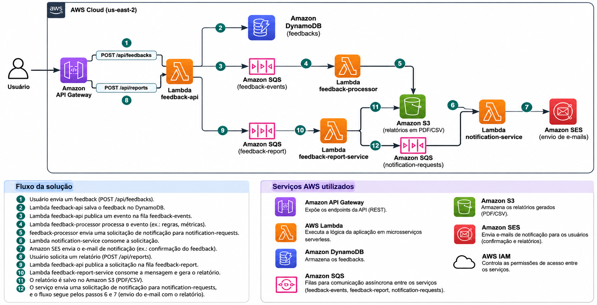
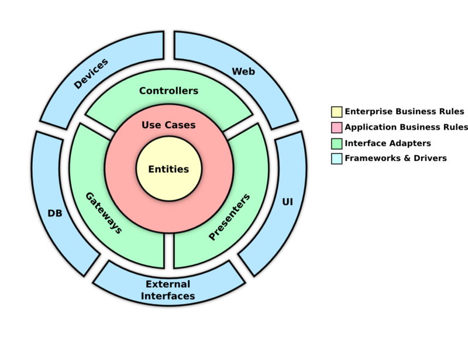

# feedback-api

Microsservico responsavel por receber feedbacks, persistir no DynamoDB e publicar solicitacoes de relatorio semanal em uma fila SQS.

## Visao geral

O projeto combina API sincrona com processamento assincrono:

- **Entrada HTTP**: recebe feedbacks e solicitacoes de relatorio.
- **Persistencia**: grava feedbacks na tabela `feedbacks` no DynamoDB.
- **Mensageria**: publica evento de relatorio na fila SQS configurada.

## Stack

- Java 21
- Quarkus 3.40.1.1
- Quarkus REST + Jackson
- Quarkus Amazon DynamoDB
- Quarkus Amazon SQS
- MapStruct
- Lombok
- LocalStack (desenvolvimento local)
- Docker

## Arquitetura da solução



## Arquitetura limpa



### Fluxo de feedback

1. `POST /api/feedbacks`
2. cria `Feedback` com urgencia, `sentAt` e `periodWeek` calculado
3. persiste no DynamoDB
4. retorna `201 Created`

### Fluxo de relatorio

1. `POST /api/reports` com uma `date`
2. calcula `periodWeek` (ISO `YYYY-Www`)
3. publica evento JSON no SQS
4. retorna `202 Accepted`

## Endpoints

| Endpoint | Metodo | Objetivo |
| --- | --- | --- |
| `/api/feedbacks` | `POST` | Criar e persistir feedback |
| `/api/reports` | `POST` | Solicitar geracao de relatorio semanal |

## Contratos da API

### Criar feedback

#### Request

```json
{
  "description": "Atendimento demorou mais do que o esperado.",
  "rating": 3
}
```

#### Response (`201`)

```json
{
  "id": "b661e71f-3c46-43e2-bd68-78d9597c256b",
  "description": "Atendimento demorou mais do que o esperado.",
  "rating": 3,
  "urgency": "HIGH",
  "createdAt": "2026-11-22T14:00:00Z"
}
```

### Solicitar relatorio semanal

#### Request

```json
{
  "date": "2026-11-20"
}
```

#### Response (`202`)

```json
{
  "status": "ACCEPTED",
  "message": "Report request accepted",
  "queueName": "feedback-report"
}
```

#### cURL

```bash
curl --request POST \
  --url http://localhost:8080/api/reports \
  --header 'Content-Type: application/json' \
  --data '{
    "date": "2026-11-20"
  }'
```

## Contrato do evento SQS (relatorio)

Payload publicado na fila configurada em `feedback.report.queue.name`:

```json
{
  "date": "2026-11-20",
  "periodWeek": "2026-W47"
}
```

## Recursos AWS

### DynamoDB

- Tabela: `feedbacks` (configuravel via `FEEDBACK_TABLE_NAME`)
- Chave primaria: `id`
- GSI: `periodWeek-createdAt-gsi` (`periodWeek` + `createdAt`)

### SQS

- Fila de relatorio: `feedback.report.queue.name` (default: `feedback-report`)
- Fila de notificacao: `feedback.notification.queue.name` (default: `notification-queue`)

> Observacao: em `application-local.properties` o default da fila de relatorio e `feedback-events`. Alinhe o nome da fila com seu ambiente via variavel `FEEDBACK_REPORT_QUEUE_NAME` ou ajuste sua infraestrutura local.

## Variaveis de ambiente principais

- `AWS_REGION`
- `FEEDBACK_TABLE_NAME`
- `FEEDBACK_REPORT_QUEUE_NAME`
- `FEEDBACK_NOTIFICATION_QUEUE_NAME`
- `QUARKUS_HTTP_PORT`
- `QUARKUS_HTTP_HOST`
- `AWS_ACCESS_KEY_ID` e `AWS_SECRET_ACCESS_KEY` (uso local com credenciais estaticas)

## Execucao local

### Rodar em modo dev

```bash
./mvnw quarkus:dev -Dquarkus.profile=local
```

Quarkus Dev UI: <http://localhost:8080/q/dev/>

### Provisionamento local (LocalStack)

O projeto possui script em `localstack/init/ready.d/init-localstack.sh` para criar:

- tabela DynamoDB `feedbacks` com GSI `periodWeek-createdAt-gsi`
- filas SQS `report-queue` e `notification-queue`

Se usar esse script, ajuste `FEEDBACK_REPORT_QUEUE_NAME=report-queue` para manter consistencia com a aplicacao.

## Build, testes e empacotamento

```bash
./mvnw test
./mvnw clean package
./mvnw clean package -DskipTests
```

## Deploy

Existe workflow em `.github/workflows/deploy-ecr.yml` para:

1. build nativo com perfil `lambda`
2. push da imagem para ECR
3. update da funcao Lambda

## Estrutura resumida

- `src/main/java/com/feedback/application/` - casos de uso, DTOs e mappers
- `src/main/java/com/feedback/domain/` - modelo de dominio e contratos
- `src/main/java/com/feedback/infrastructure/` - controllers, persistencia e mensageria
- `src/main/resources/application.properties` - configuracao base
- `src/main/resources/application-local.properties` - configuracao local com LocalStack
- `localstack/init/ready.d/init-localstack.sh` - bootstrap de recursos locais

## Observacoes

- O calculo de `periodWeek` usa semana ISO (`YYYY-Www`) a partir da data de referencia.
- O endpoint de relatorio valida obrigatoriedade de `date`.
- A geracao do relatorio em si e processada por servico consumidor da fila SQS.
